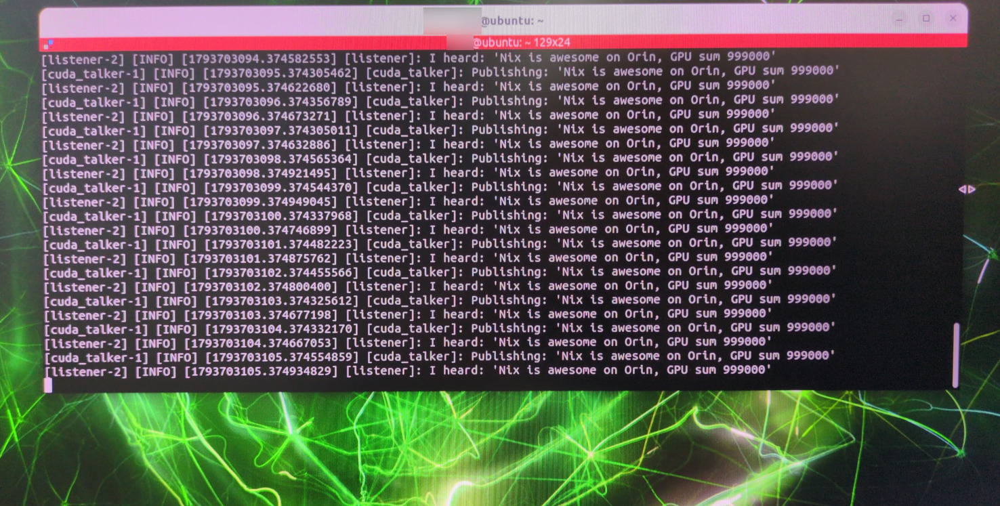
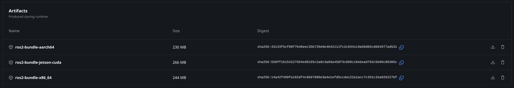

# ROS2 Bundle with Nix

I am by no means a Nix expert, but I wanted a sane, repeatable way to build and deploy my robotics stack. Think of this repository as a documented template you can grab, pull apart, and start hacking on.

This repo contains an oversimplified workspace with:
- [my_awesome_package](./src/my_awesome_package/): a talker/listener package
- [my_awesome_interfaces](./src/my_awesome_interfaces/): A custom interfaces package
- [my_awesome_bringup](./src/my_awesome_bringup/): A bringup/integration package

I use Nix to build this workspace with Jazzy, and bundle the result as a standalone executable. I've added Zenoh as default RMW in the mix as extra complexity because why not.

## Intro

I highly recommend this introductory read [ROS 2 with Nix](https://sgvd.ai/post/2026-03-25-ros2-with-nix/), also I assume you already have Nix [installed](https://nix.dev/install-nix.html) in your machine and flakes enabled.

The [flake](./flake.nix) is commented to help you follow along, it defines:
- **default dev shell**: an isolated terminal environment with all ROS 2 build tools and dependencies.
- **ros2-workspace**: the pre-compiled, raw ROS 2 environment.
- **ros2-bundle**: an executable wrapper to bring up the whole stack.

You can use this single configuration file as a blueprint to go from local hacking in a clean development sandbox to bundling your entire ROS 2 project into a standalone executable.

> [!TIP]
> Also make sure `trusted-users = root <YOUR_USERNAME> ` is in `/etc/nix/nix.conf` or you won't be able to pull cached ROS2 packages from [cachix](https://app.cachix.org/cache/ros), and you will end compiling everything from scratch.

Mandatory thanks to [lopsided98/nix-ros-overlay](https://github.com/lopsided98/nix-ros-overlay), which is the project that actually provides everything required to make ROS 2 work flawlessly with Nix. The maintainers deserve all the praise for making this possible.

## Local Development
Nix perfectly supports your usual ROS development workflow. 

The best part? Unlike jumping into a Docker container, the Nix dev shell doesn't strip away your local environment. It simply layers the ROS goodies (`colcon`, `ros2`, etc.) *directly on top* of your host machine. Your system's `git`, your customised `nvim`, and your preferred IDE are all still right there.

Enter the Jazzy development shell:
```bash
nix develop
echo $RMW_IMPLEMENTATION
colcon build --base-paths src # This builds locally into your install/ and build/ directories
```

Spin the zenoh router daemon:
```bash
ros2 run rmw_zenoh_cpp rmw_zenohd
```

Run your awesome ros nodes (each in its own terminal, with `nix develop` in every one of them!):
```bash
source install/setup.bash
ros2 run my_awesome_package talker
ros2 run my_awesome_package listener
```

> [!NOTE]
> **You don't have to follow the next steps to bundle your ROS project**, feel free to skip to  [the next part](#deploying-your-stack-to-a-robot), just follow along if you are curious to dive deeper into managing the compiled workspace as a nix package.

Nix can build the workspace as a package, giving you all the Nix benefits (this is not a deep dive BUT there are many). Maybe this works better for your workflow.
```bash
nix build .#ros2-workspace
ls result # it will create a result directory that symlinks to the `nix/store`
./result/bin/ros2 run rmw_zenoh_cpp rmw_zenohd
./result/bin/ros2 run my_awesome_package talker
```

Probably it is better to have a single entry point script for your stack, and the ros2-bundle defined in the flake is a Nix package that does just that!
```bash
nix build # defaults to ros2-bundle
./result/bin/ros2-bundle # you can actually run this and will launch the bringup
```

Indeed that same executable is what is run with:
```bash
nix run .#ros2-bundle

```
> [!WARNING]
> Now don't try just copying this on your robot just yet! The result has the dependencies linked to the `/nix/store`!

If your robot actually does have Nix installed, we can sync the packaged workspace and all its dependencies securely over SSH:
```bash
nix copy .#ros2-bundle --to ssh://nuc@192.168.1.X
```

> [!TIP]
> I am using the default arx archive but Nix supports multiple [bundlers](https://nix.dev/manual/nix/2.24/command-ref/new-cli/nix3-bundle#examples), you can export your ros stack as an AppImage for example.

## Sane ARM build

Cross-compiling for ARM (Jetson, Raspberry Pi, etc.) can be painful. An easy workflow is leveraging [QEMU](https://wiki.archlinux.org/title/QEMU) user-mode emulation to build `aarch64-linux` binaries directly on your `x86_64` workstation, no cross-compilation toolchain wrangling or rebuilding on the SBC required!

```bash
# check the correct pkgs for your distro
sudo pacman -S qemu-user-static
sudo pacman -S qemu-user-static-binfmt
# edit /etc/nix/nix.conf and add extra-platforms = aarch64-linux
sudo systemctl restart nix-daemon
nix bundle .#ros2-bundle --system aarch64-linux
```

Boom! The output binary can run native on your Jetson! And the bundled ros version does not care about your JetPack version!

Most of the ROS dependency tree comes pre-built from `ros.cachix.org`! Only your custom workspace packages (my_awesome_*) actually build under QEMU. And this saves the pain of compiling directly on the robot.

Likewise, if you prefer the Nix-managed way, you can still:
```bash
nix copy '.#packages.aarch64-linux.ros2-bundle' --to ssh://nuc@192.168.1.X
```

Be mindful that `.#ros2-bundle` on your x86_64 dev machine resolves to the x86_64 build. The explicit packages.aarch64-linux.ros2-bundle is the aarch64 one.

## Jetson with jetpack-nixos

What if you want to use the GPU on your Jetson? The [jetpack-nixos](https://github.com/anduril/jetpack-nixos) overlay gives us NVIDIA's CUDA for Jetson as plain Nix packages, so we can build a CUDA node right next to the rest of the workspace.

The flake has a minimal example for a Jetson Orin running the stock Ubuntu JetPack 6 (again, no nix/NixOS on the robot required!):
- [my_awesome_cuda](./src/my_awesome_cuda): a talker that does a vector addition on the GPU and publishes the result.
- **ros2-bundle-jetson**: same as ros2-bundle, but it launches the CUDA talker with the usual listener.

Build it with the same QEMU trick as above:
```bash
nix bundle .#ros2-bundle-jetson --system aarch64-linux
```

Copy it to your Jetson and run it:
```bash
scp ros2-bundle-jetson-arx robot_user@192.168.1.100:~/
ssh robot_user@192.168.1.100
./ros2-bundle-jetson-arx
# [listener]: I heard: 'Nix is awesome on Orin, GPU sum 999000'
```

<figure>
  
</figure>

> [!NOTE]
> The CUDA driver (`libcuda.so`) must match the robot's kernel, so the bundle doesn't ship it and uses the one from JetPack in `/usr/lib/aarch64-linux-gnu/nvidia` instead. Everything else (CUDA runtime, ROS, your nodes) is in the bundle.

The `my_awesome_cuda` package has a `COLCON_IGNORE`, so `colcon build` in the dev shell skips it (no `nvcc` there), and Nix builds it just fine.

## One more thing!

If you are not impressed so far with Nix, here one last trick.

You don't even have to bundle this yourself, the CI can do it for you via [GH Actions](.github/workflows/build.yml)!

Check out this repo's [Action artifacts](https://github.com/mcarfagno/ROS2-bundle-with-nix/actions/workflows/build.yml), you can download and run the bundled application yourself on your x86 Linux machine!
There is an ARM one too (`ros2-bundle-aarch64`, built on a native ARM runner), which also runs on a Jetson, and a Jetson one with CUDA (`ros2-bundle-jetson-cuda`).
<figure>
  
</figure>

It's ultra fast thanks to the [cachix](https://app.cachix.org/cache/ros) cache!
